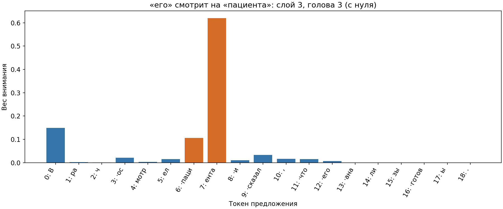
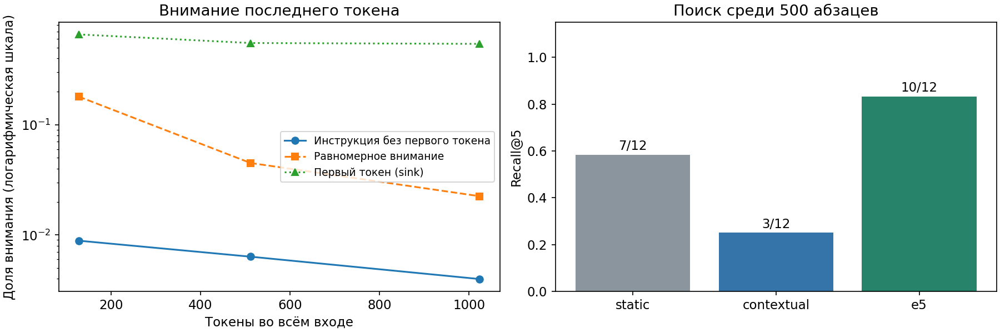

# Лабораторная 2. Токены, векторы, внимание

## Что сделано

Выполнены четыре обязательные части [задания](https://github.com/pmenshih/tgo-course/blob/main/assignments/02/README.md). Скрипт обучает собственный BPE на «Войне и мире», сравнивает токенизацию русского и английского, ищет абзацы тремя способами и измеряет внимание Qwen. Обучение и применение BPE импортируются из нашей реализации [pt01/run.py](../pt01/run.py). Библиотеки готовых токенизаторов для собственного BPE не используются.

Полный прогон выполнен в [Colab](https://colab.research.google.com/drive/1vU-ayEboHUyhUNtZTbAt86Oi-BYRmMC2) на Tesla T4, FP16. Время скрипта с обучением BPE и вычислениями моделей: 62.9 с; установка библиотек в него не входит. [Ноутбук](lab02_colab.ipynb) сохранён с выполненными ячейками и графиками. [Метаданные](artifacts/run_metadata.json) содержат версии библиотек, ревизии моделей, хеши исходников и результатов. Книга читается как байты с декодированием UTF-8, без замены исходных CRLF на LF. Так первый запуск после скачивания и запуск из кэша дают одинаковый вход.

На облачной машине из любой рабочей папки:

```sh
python -m pip install -r /path/to/tgo-course/lab02/requirements.txt
python /path/to/tgo-course/lab02/run.py --device cuda
```

`--fast` обучает 200 слияний, берёт 60 абзацев и входы длиной 64, 256, 768 токенов. Без флага: 1500 слияний, 500 абзацев, длины 128, 512, 1024. CPU предназначен для облачного CI. Для отдельного повторного прогона задайте `--artifacts /content/lab02-repeat`, чтобы сохранить основной результат. Корпус и веса моделей не входят в репозиторий.

`from lab02.run import count_tokens` даёт функцию подсчёта токенов Qwen без загрузки весов модели. `ParagraphSearch` принимает модель, токенизатор и абзацы; после `index()` метод `search(query, k=5)` возвращает номера ближайших абзацев. Правильные ответы используются только при оценке после поиска. Для Qwen усредняются все настоящие токены, padding исключается; для E5 используются префиксы `query: ` и `passage: ` и усреднение по маске по [инструкции автора модели](https://huggingface.co/intfloat/multilingual-e5-small). В полном прогоне обрезано входов E5: 0.

## Что получилось

**Собственный BPE.** 1500 слияний, словарь 1534 токена. На 433082 словах получено 836977 токенов, в среднем 1.933 токена на слово. Сжатие относительно букв: 2.683 раза. Повторное обучение дало тот же `bpe.json`, который используется в lab03.

**Бюджет контекста Qwen.** Русский фрагмент состоит из нормализованных слов книги с индексами 500:600, английский абзац взят дословно из задания. Специальные токены не добавляются.

| Язык | Слов | Токенов | Токенов на слово | Слов в 4096 токенах |
|---|---:|---:|---:|---:|
| Русский | 100 | 198 | 1.980 | 2068 |
| Английский | 70 | 81 | 1.157 | 3539 |

В этих фрагментах русский текст дороже: Qwen разбивает его слова на большее число токенов. Поэтому одинаковое число слов документов занимает разную часть промпта. Числа в последнем столбце приблизительны и относятся к этим двум фрагментам; для настоящего запроса нужен `count_tokens` всего текста вместе с инструкцией.

**Поиск среди 500 абзацев.** Recall@5 равен числу запросов, для которых правильный абзац попал в первую пятёрку, делённому на 12.

| Способ | Попаданий из 12 | Recall@5 |
|---|---:|---:|
| static | 7 | 0.583 |
| contextual | 3 | 0.250 |
| e5 | 10 | 0.833 |

E5 оказалась лучше. Она обучена сопоставлять запрос и подходящий текст, поэтому её косинусное расстояние соответствует задаче поиска. Static сохраняет признаки токенов и на этом наборе находит больше ответов, чем contextual. Последний слой Qwen учитывает контекст, но обучен для предсказания продолжения; простое среднее его состояний не обязано быть хорошим вектором абзаца для поиска. Сам эксперимент показывает порядок способов, но не выделяет единственную причину всех ошибок.

E5 не нашла правильный абзац в первой пятёрке для запросов 1, 7. Все номера, формулировки запросов и пятёрки сохранены в [search.json](artifacts/search.json). Это фиксированный учебный набор из 12 запросов, вывод не распространяется автоматически на другие документы.

**Внимание к антецеденту.** В предложении «Врач осмотрел пациента и сказал, что его анализы готовы.» последнему токену «его» соответствует позиция 12, слову «пациента» позиции [6, 7]. Максимум найден на слое 3, голове 3 при нумерации с нуля. Сумма весов на токенах «пациента» равна 0.725586, или 72.56%. Это выбранная максимальная голова, а не среднее внимание всей модели и не самостоятельное доказательство понимания местоимения.



**Длинный контекст.** Инструкция занимает 23 токена без первого. Измеряется внимание последнего токена входа, усреднённое по всем слоям и головам. Первый токен, attention sink, считается отдельно.

| Токенов во входе | На инструкцию | На первый токен | При равномерном внимании |
|---:|---:|---:|---:|
| 128 | 0.8875% | 65.82% | 17.9688% |
| 512 | 0.6354% | 55.01% | 4.4922% |
| 1024 | 0.3983% | 54.04% | 2.2461% |

При увеличении входа доля внимания к инструкции уменьшается. В промпт с найденными документами стоит класть подходящие фрагменты, а не всё подряд. Этот замер показывает распределение внимания Base-модели на одном тексте; он не измеряет частоту выполнения инструкции и не задаёт универсальный предел длины промпта. Для проверки соблюдения инструкции нужна отдельная генерация ответов чат-моделью.



## Что не получилось и почему

При проверке воспроизводимости обнаружилось, что `read_text()` преобразует CRLF в LF и меняет токены наполнителя. В диагностическом прогоне с LF доли внимания составили 1,8255%, 0,4190% и 0,4610%: последнее значение выросло. [Данные этой проверки и её исходник](newline_diagnostic.json) сохранены. Итоговый скрипт сохраняет исходные переводы строк корпуса на свежем и повторном запуске; он воспроизвёл исходные доли без изменения текстов инструкции или запросов. Это также показывает, что строгое снижение на каждом шаге не является универсальным свойством внимания.

Contextual не улучшил поиск: простое усреднение последнего слоя Qwen дало меньше попаданий, чем таблица эмбеддингов. E5 тоже ошибается на части запросов. Результаты оставлены как получены, порядок способов не подгонялся. Бонусы с генерацией «КОНЕЦ», многозначными словами и дополнительными запросами не выполнялись.

Обязательные результаты проверяются актуальными автотестами преподавателя. Дополнительные проверки в `lab02/tests` заново строят ранжирование по сохранённым векторам, пересчитывают доли внимания по сохранённым строкам и сверяют хеши. Они работают без запуска нейросетей. CI сначала проверяет полные результаты Colab, затем делает новый быстрый прогон на CPU GitHub Actions. Выполнение работы и прохождение тестов не заменяют устную проверку преподавателя.
