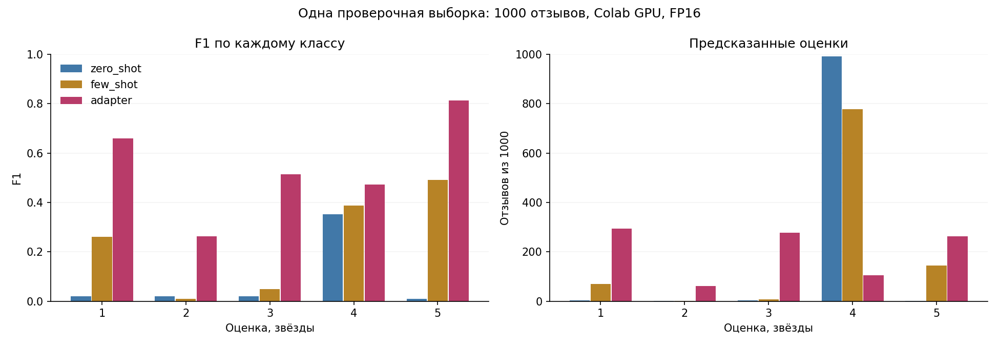
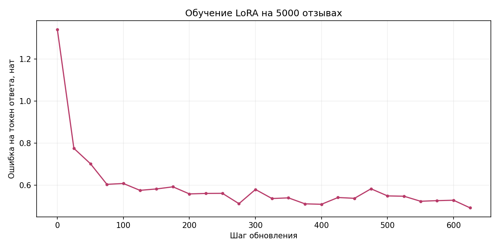

# Лабораторная 4. Дообучение под узкую задачу

## Что сделано

Модель Qwen3-0.6B использована для предсказания оценки от 1 до 5 по тексту отзыва об организации. Сравнены три способа решения: zero-shot с описанием задачи, few-shot с пятью примерами в запросе и та же модель с обученным адаптером LoRA. Обучение и итоговая оценка выполнены в Google Colab на Tesla T4. Все три режима проверены заново в одной среде FP16; прежние локальные эксперименты в итоговую таблицу не включены.

Из mteb/GeoreviewClassification выбраны 5000 обучающих отзывов, по 1000 на каждый класс, с seed = 42. Для few-shot взят первый отзыв каждого класса из validation, индексы 6, 8, 3, 0, 1 в порядке оценок 1-5. Эти примеры одинаковы во всех запросах. Проверочная выборка состоит из первых 1000 отзывов test в исходном порядке: 191 единица, 196 двоек, 193 тройки, 214 четвёрок и 206 пятёрок. Метки набора 0-4 преобразованы в оценки 1-5. Точных совпадений текстов между выбранными обучающей, проверочной и few-shot выборками нет. В закреплённой версии набора test содержит 2048 строк, хотя в описании задания указано 2000; для эксперимента использован требуемый префикс из 1000 строк. Индексы и контрольные суммы сохранены в [data_check.json](artifacts/data_check.json).

Во всех режимах системный запрос задаёт шкалу оценок, затем передаётся отзыв и просьба ответить одной цифрой. Правильная оценка проверочного отзыва в запрос не попадает. Применён шаблон чата Qwen с enable_thinking=False, жадный выбор и ограничение в три новых токена. Few-shot добавляет пять пар «отзыв - правильная оценка» как предыдущие реплики диалога. Ответ разбирается как единственное отдельное целое число от 1 до 5; остальные ответы учитываются как invalid. При итоговой оценке отзывы не обрезаются, веса не обновляются. [Код запроса и разбора](prompting.py) общий для режимов.

LoRA добавляет обучаемую поправку к линейным преобразованиям модели, оставляя исходные веса замороженными. Адаптер ранга 8 с alpha = 16 установлен на q_proj, k_proj, v_proj, o_proj, gate_proj, up_proj и down_proj. Обучались 5 046 272 параметра из 601 096 192 параметров модели с адаптером, то есть 0,8395%. Использован AdamW: шаг обучения 0,0002, weight decay 0,01, одна эпоха и 625 обновлений. Эффективный батч равен 8: четыре микробатча по 2 примера с накоплением градиента. Смешанная точность FP16 использует масштабирование градиента; его норма ограничена единицей.

Обучающий диалог ограничен 256 токенами. Лосс считается по цифре ответа и маркеру конца сообщения, а позиции промпта и дополнения батча маскируются значением -100. Для сохранения инструкции и ответа при превышении длины сокращается сам отзыв. Обучение заняло 20,86 минуты, пиковый объём памяти тензоров CUDA составил 2,255 ГБ. Время включает цикл обучения, запись журнала и промежуточных адаптеров, но исключает скачивание модели, подготовку данных и начальный/конечный контрольный замер. Пропущенных обновлений нет, исходные веса модели сохранились, изменились 392 тензора адаптера. Настройки и версии библиотек приведены в [train_config.json](artifacts/train_config.json), выполненные ячейки сохранены в [train.ipynb](train.ipynb).

## Что получилось

На 1000 отложенных отзывах LoRA дала 580 точных ответов против 219 у zero-shot и 318 у few-shot. Все 3000 ответов разобрались как допустимые оценки, доля invalid во всех режимах равна нулю.

| Режим | Точность | Macro-F1 | MAE, звёзды | Секунд на отзыв | Токенов запроса в среднем | Пик CUDA, ГБ |
|---|---:|---:|---:|---:|---:|---:|
| Zero-shot | 0,219 | 0,0846 | 1,355 | 0,0938 | 260,259 | 1,416 |
| Few-shot | 0,318 | 0,2401 | 1,227 | 0,1816 | 1388,259 | 1,576 |
| LoRA | 0,580 | 0,5442 | 0,524 | 0,1707 | 260,259 | 1,472 |

Точность равна доле точных совпадений. Для каждой оценки F1 = 2TP / (2TP + FP + FN), где TP обозначает правильные ответы этого класса, FP - ошибочное назначение класса, FN - пропущенные ответы класса. Macro-F1 усредняет пять F1 с одинаковым весом. MAE усредняет абсолютное расстояние между предсказанной и настоящей оценками. Некорректный ответ считается ошибкой для точности и F1, исключается из MAE и отдельно попадает в invalid. Здесь таких ответов нет, поэтому знаменатель MAE равен 1000. Все ответы находятся в [predictions.csv](artifacts/predictions.csv), расчёты и матрицы ошибок в [metrics.json](artifacts/metrics.json).

Few-shot повысил точность на 9,9 процентного пункта, macro-F1 на 0,1555 и уменьшил MAE на 0,128 звезды. Цена пяти примеров составляет ровно 1128 дополнительных токенов на каждый запрос: средняя длина выросла с 260,259 до 1388,259 токена. При последовательной обработке отзывов время ответа выросло примерно в 1,94 раза. Zero-shot поставил 4 в 991 случае, few-shot в 777: примеры помогли чаще распознавать крайние оценки, но почти не научили модель выбирать 2 и 3.

LoRA повысила точность относительно zero-shot на 36,1 процентного пункта, macro-F1 на 0,4596 и уменьшила MAE на 0,831 звезды. Относительно few-shot получено на 262 точных ответа больше, macro-F1 выше на 0,3041. Длина запроса осталась такой же, как у zero-shot, поскольку примеры в контекст не добавляются. Адаптер используется без слияния с базовыми весами, поэтому короткий запрос сам по себе не означает такое же время вычисления: в этом прогоне LoRA занимала 0,1707 секунды на отзыв против 0,0938 у zero-shot.

| Настоящая оценка | Отзывов | F1 zero-shot | F1 few-shot | F1 LoRA | Точных ответов LoRA |
|---|---:|---:|---:|---:|---:|
| 1 | 191 | 0,0206 | 0,2615 | 0,6598 | 160 |
| 2 | 196 | 0,0202 | 0,0101 | 0,2636 | 34 |
| 3 | 193 | 0,0204 | 0,0498 | 0,5138 | 121 |
| 4 | 214 | 0,3519 | 0,3875 | 0,4717 | 75 |
| 5 | 206 | 0,0097 | 0,4914 | 0,8120 | 190 |

Наибольший прирост F1 относительно zero-shot получен для пятёрок (+0,8023) и единиц (+0,6392). Для троек прирост составляет +0,4934. F1 четвёрок тоже вырос, хотя число угаданных четвёрок снизилось с 212 до 75: модель перестала приписывать этот класс почти всем отзывам, и число ложных четвёрок сократилось с 779 до 29.

Средняя обучающая ошибка за первые 25 обновлений равна 0,7744, за последние 25 равна 0,4914 ната на токен ответа. Контрольный замер на одних и тех же восьми обучающих примерах снизился с 1,3391 до 0,6754. Точка 0 на графике относится к этому начальному замеру; остальные точки усредняют ошибку по предыдущим 25 обновлениям, поэтому их нельзя читать как одну фиксированную проверочную выборку. Журнал приведён в [train_log.csv](artifacts/train_log.csv).

Итоговая оценка выполнена в PyTorch 2.14.1+cu130, Transformers 4.57.1 и PEFT 0.17.1. Сохранённый [ноутбук сравнения](evaluate_colab.ipynb) содержит выводы всех трёх режимов. Время ответа измерено после отдельного прогрева каждого режима, с синхронизацией GPU; оно включает шаблон чата, токенизацию, генерацию и разбор ответа, но исключает загрузку модели и запись файлов. Отзывы обрабатываются по одному, без общего кеша между запросами. Память указана как пик выделенных тензорам CUDA байтов, делённый на 10⁹, включая веса. Это измерения одной T4 и одного прогона.

## Что не получилось и почему

После LoRA остаются 420 неверных оценок. Среди 196 настоящих двоек модель правильно определила только 34, а 91 отнесла к единицам и 64 к тройкам. Из 214 четвёрок 73 стали тройками и 56 пятёрками. Это показывает, что модель хуже различает соседние промежуточные оценки, чем крайние значения. Сам эксперимент не устанавливает единственную причину: для проверки влияния формулировок отзывов, объёма обучения и параметров адаптера нужны отдельные сравнения.

| Абсолютная ошибка, звёзды | Zero-shot | Few-shot | LoRA |
|---|---:|---:|---:|
| 0 | 219 | 318 | 580 |
| 1 | 397 | 318 | 334 |
| 2 | 194 | 193 | 71 |
| 3 | 190 | 161 | 12 |
| 4 | 0 | 10 | 3 |

У LoRA 334 ошибки на одну звезду, преимущественно между соседними оценками: 2 → 1 встречается 91 раз, 4 → 3 - 73 раза, 2 → 3 - 64 раза, 4 → 5 - 56 раз. Из 12 ошибок на три звезды семь имеют вид 4 → 1, четыре 2 → 5 и одна 1 → 4. Ещё три отзыва с оценкой 1 получили 5. Суммарное расстояние равно 334 + 2 × 71 + 3 × 12 + 4 × 3 = 524, откуда MAE = 524 / 1000 = 0,524. В 914 случаях из 1000 промах не превышает одной звезды.

Macro-F1 и MAE отвечают на разные вопросы. F1 показывает, насколько хорошо распознаётся каждый класс: ошибка 2 → 1 и ошибка 2 → 5 одинаково означают пропущенную двойку. MAE учитывает расстояние и сильнее штрафует второй случай. Поэтому низкая MAE может сочетаться со слабым распознаванием двоек, если модель часто выбирает соседние значения. Нулевое число ошибок на четыре звезды у zero-shot также не означает высокое качество: почти постоянный ответ 4 дал 190 ошибок на три звезды и macro-F1 всего 0,0846.

Из-за ограничения в 256 токенов при обучении сокращены 1910 из 5000 отзывов. В них модель видела только начало текста, хотя при оценке получала полный отзыв. Это возможный источник потери информации, но его вклад не измерен отдельным экспериментом. Падение ошибки на обучающих данных само по себе не доказывает обобщение; вывод об улучшении основан на общей отложенной тысяче. Результат относится к одному отбору обучающих данных, одной эпохе и одному набору few-shot примеров; другие seed и примеры в этом сравнении не проверялись.
