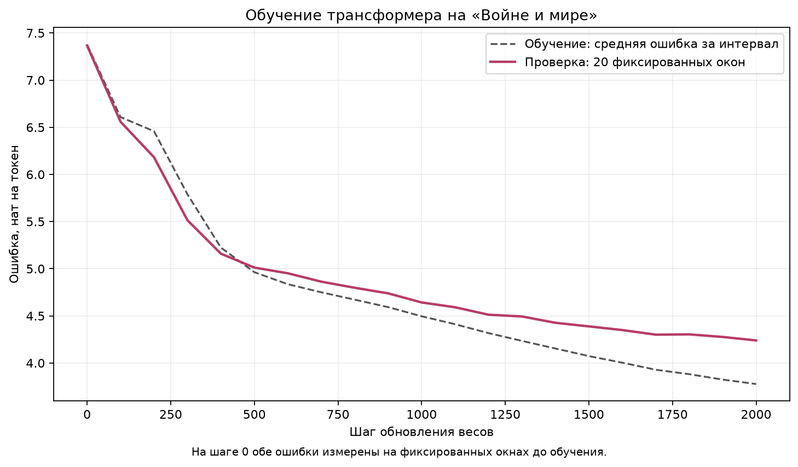

# Работа 2. Свой трансформер: обучение и генерация

## Что сделано

На тексте романа Л. Н. Толстого «Война и мир» обучен небольшой декодерный трансформер для предсказания следующего токена. Текст приведен к нижнему регистру, «ё» заменена на «е», слова выделены регулярным выражением `[а-я]+(?:-[а-я]+)*`. Первые 90% слов использованы для обучения, последние 10% для проверки. После разделения слова преобразованы в токены сохраненным BPE из первой работы: 1500 слияний, словарь 1534 токена. Правила BPE при обучении трансформера не изменялись.

Модель содержит обучаемые эмбеддинги токенов и позиций, четыре блока трансформера и выходной линейный слой в словарь. Размерность векторов равна 128, в каждом блоке четыре головы внимания по 32 координаты и полносвязная сеть размерности 512 с GELU. Внимание реализовано через проекции Q, K, V, масштабированное скалярное произведение, причинную маску, softmax и взвешенную сумму значений. Маска запрещает смотреть на будущие токены. Перед вниманием и полносвязной сетью применяется LayerNorm; результаты обеих ветвей прибавляются к входным представлениям через остаточные связи. Контекст ограничен 128 токенами. Число обучаемых параметров составляет 1 200 384.

Обучение выполнено на CPU с четырьмя вычислительными потоками в PyTorch 2.15.0. Использован AdamW с шагом 0.001 и weight decay 0.01; seed = 42. Полный прогон включает 2000 обновлений весов, батч состоит из 32 случайных окон по 128 токенов. Цели сдвинуты относительно входов на один токен вперед, ошибка рассчитывается как средняя кросс-энтропия по всем позициям. Каждые 100 шагов оценивается ошибка на 20 фиксированных окнах отложенного текста без обновления весов. Быстрый режим предусматривает 200 шагов, батч 16 и замеры каждые 25 шагов. [Параметры прогона](artifacts/tiny_config.json) содержат размеры данных и настройки обучения.

Для затравки «князь андрей» сохранены образцы на шагах 0, 100, 500 и 2000. После обучения сравнены жадный выбор, температуры 0.7 и 1.5, а также температура 1.0 с top-p = 0.9. Качество предсказания настоящего текста сопоставлено с биграммной моделью из первой работы на первых 2000 словах отложенной части.

## Что получилось

Обучающая часть содержит 389 773 слова и 753 521 BPE-токен, проверочная часть содержит 43 309 слов и 83 456 токенов. Полный цикл обучения занял 83.41 секунды (1.39 минуты). Время включает замеры ошибки и генерацию промежуточных образцов; подготовка данных и построение графика в него не входят.

Ошибка измеряется в натах на BPE-токен. На шаге 0 обе оценки получены на фиксированных окнах до обучения. Далее обучающая ошибка усреднена по батчам за предыдущие 100 шагов, а проверочная каждый раз измерена на одних и тех же 20 окнах.

| Шаг | Обучающая ошибка | Проверочная ошибка |
|---:|---:|---:|
| 0 | 7.3775 | 7.3667 |
| 100 | 6.6081 | 6.5588 |
| 500 | 4.9630 | 5.0119 |
| 1000 | 4.4958 | 4.6424 |
| 2000 | 3.7770 | 4.2395 |

Проверочная ошибка снизилась с 7.3667 до 4.2395, поэтому улучшение наблюдается и на тексте, который не использовался для обновления весов. К концу прогона обучающая ошибка снижается быстрее проверочной; разница между ними увеличивается, а улучшение на отложенном тексте замедляется. Полная последовательность замеров приведена в [train_curve.csv](artifacts/train_curve.csv).

Образцы по шагам получены при температуре 0.8. Каждый содержит затравку и 60 новых токенов; перед каждым образцом генератор случайных чисел инициализирован одинаковым seed = 46.

Шаг 0:

> князь андрей каксами довсю ний начальдеть ядаже ге самынувнииз гудесподошел общнавесше целревошел обратился нем никто онлся ку готоподония нядвижение тся тотчас скавый чу ехать нимпоняходили ражениь ющсвоими получерсталучше той сознагорглавнокоманка ете комнату подле

Шаг 100:

> князь андрей ы бдоке она начальруядаже нентоениз гус прообщнавесв как рене рее он онлся ку готоподоунясказала в искачто из опьер он что ми ь шлои чистадатой на а и ка в нела

Шаг 500:

> князь андрей усами дой обностью он даже нею что ни из тех его прообщнапусие ресела ее он с князку и подошли в петербурге искакал из осному и по шлом и ставленно сознанием и княжна марья опла

Шаг 2000:

> князь андрей не мог договорить об этом начале в самых жестолом и общество в терете и неожиданности шиншин начальство в исках из армии пьер уехал в дриссковский прочрежден был в нела

До обучения преобладают склеенные части слов. После 2000 шагов появляются сочетания «не мог договорить об этом» и «пьер уехал», однако весь фрагмент остается несвязным. Снижение ошибки улучшило предсказание отдельных продолжений, но не обеспечило связность текста на протяжении всего образца. Полные записи находятся в [samples.json](artifacts/samples.json).

В сравнении режимов каждый образец содержит 80 новых токенов; для случайного выбора seed = 42 установлен отдельно перед каждым режимом. В таблице приведены начала текстов, полные тексты и номера токенов сохранены в [generation.json](artifacts/generation.json).

| Режим | Новых токенов | Начало повторной четверки, индекс от 0 | Начало образца |
|---|---:|---|---|
| Жадный выбор | 80 | 14 | князь андрей не мог быть успеть его не было в том что он был в том что он был в нем деле и не мог понять того что о… |
| Температура 0.7 | 80 | Не оценивается | князь андрей встретился с своих гостей и жена было так же как и эта никогда не могла не сделать и ней но она знала … |
| Температура 1.5 | 80 | Не оценивается | князь андрей встрепротив что вензал он испугался глазами масон сделался эта никогда николушки в мы ней нельзя решит… |
| Температура 1.0, top-p = 0.9 | 80 | Не оценивается | князь андрей встретился добродетельным женой княгини обращался ему около стенском всхудовой он не мог удержаться от… |

Жадная генерация многократно повторяет сочетание «что он был в том». По критерию задания первая повторная четверка «в том что он» начинается с индекса 14 среди новых токенов; ее первое вхождение начинается с индекса 9. Жадный выбор на каждом шаге берет максимальную оценку, поэтому попавшее в текст повторяющееся продолжение может снова стать наиболее вероятным. Повтор четверки служит заданным признаком зацикливания, а не доказательством бесконечного цикла.

Температура 0.7 усиливает предпочтение вероятных токенов; в полученном образце больше привычных сочетаний, но сохраняются грамматические ошибки. При температуре 1.5 редкие токены выбираются чаще, появляются искаженные слова, например «встрепротив». Top-p = 0.9 ограничивает выбор минимальным префиксом отсортированного распределения с суммарной вероятностью не ниже 0.9, включая токен, пересекающий порог. На первом шаге осталось 252 кандидата из 1534 с исходной суммарной вероятностью 0.9001; после фильтрации вероятности перенормированы. Число кандидатов пересчитывается на каждом шаге. [Расчет первого шага](artifacts/generation_first_step.json) показывает изменение вероятностей при разных режимах.

Для сравнения моделей первое слово «это» использовано только как контекст. Обе модели оценили следующие 1999 слов; трансформер предсказал соответствующие им 3664 BPE-токена, каждый ровно один раз, с контекстом до 128 предыдущих настоящих токенов. Температура и top-p при оценке не применялись. Ошибки частей каждого слова сложены, общая сумма разделена на 2000 слов фрагмента, включая начальное контекстное слово, согласно образцу задания. Перплексия на слово рассчитана как exp от этой нормированной ошибки.

| Модель | Оцененных слов или BPE-токенов | Сумма ошибок, нат | Нат на слово | Перплексия на слово |
|---|---:|---:|---:|---:|
| Биграмма, alpha = 0.01 | 1999 | 16308.25 | 8.1541 | 3477.69 |
| Трансформер | 3664 | 15047.31 | 7.5237 | 1851.32 |

На этом фрагменте трансформер получил ошибку на слово на 7.73% ниже, чем биграмма. Биграмма использует только предыдущее слово и хранит 236 820 наблюдавшихся пар; трансформер имеет 1 200 384 параметра и учитывает более длинный контекст. Победитель не следует из числа параметров заранее: результат зависит от данных и обучения. На отдельных словах порядок меняется: ошибка на «георгий» у трансформера равна 20.0123 против 12.1485 у биграммы, а на «день» равна 0.3734 против 2.2834.

У биграммы 126 целевых слов отсутствуют в обучающем словаре и заменяются на `<UNK>`. Для проверки влияния этой особенности отдельно оценены 1873 известных ей целевых слова. Ошибка на одно такое слово составила 7.9098 у биграммы и 6.7618 у трансформера; преимущество трансформера сохранилось. Итоговые суммы и условия оценки записаны в [eval.json](artifacts/eval.json), примеры расчета по словам в [eval_word_examples.json](artifacts/eval_word_examples.json).

## Что не получилось и почему

Модель не научилась создавать связный текст на протяжении всего продолжения. В образцах остаются нарушения согласования, неожиданные переходы и несуществующие слова. Архитектура ограничена контекстом в 128 токенов, а обучение проведено на одной книге за 2000 шагов. Полученные результаты показывают освоение частотных сочетаний и частей слов, но не устойчивое сохранение темы и грамматики на длинном фрагменте.

Жадный выбор приводит к повторам, а высокая температура увеличивает долю необычных и неудачных продолжений. Фильтрация top-p уменьшает набор кандидатов, но внутри него также остаются ошибочные варианты, которым модель присвоила высокие вероятности. Поэтому настройки генерации меняют разнообразие и повторы, сохраняя ограничения обученной модели. Сравнение выполнено с одной затравкой и одним seed для каждого режима; оно описывает полученные образцы и не устанавливает универсально лучший режим.
